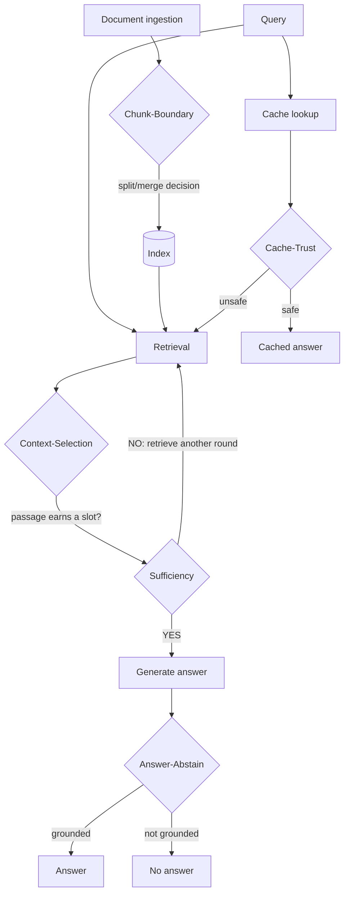

# JevRAG

**A common decision substrate for RAG (retrieval-augmented generation) pipelines** — a shared abstraction, a swappable decision backend, and a calibration-first evaluation harness.

```
state → Decision → confidence → action
```

  

```bash
pip install jevrag
# or with uv:
uv add jevrag              # in a uv project
uvx jevrag --help          # run the CLI once, no install
```

See [Quickstart](#quickstart) for keys and a first run.

| Decision | Shape | Status |
|---|---|---|
| [evidence-sufficiency](docs/primitives.md#evidence-sufficiency-n700-test-questions--the-headline-result) | iterative, multi-round | ✅ Built · evaluated (val n=300, test n=700) |
| [chunk-boundary](docs/primitives.md#chunk-boundary--the-generalization-test) | one-shot, pre-retrieval | ✅ Built · evaluated · generalization hash-proven |
| [context-selection](docs/primitives.md#context-selection--wrapped-vs-rebuilt-on-two-real-benchmarks) | one-shot, per-passage | ✅ Wrap + from-scratch rebuild, both evaluated |
| [answer-abstain](docs/primitives.md#answer-abstain--a-post-generation-grounding-check-benchmarked-against-a-free-alternative) | one-shot, post-generation | ✅ Built · benchmarked against a free alternative (n=300, tie) |
| [cache-trust](docs/primitives.md#cache-trust--extracted-from-real-prior-art-independently-corroborated) | one-shot, structural state | ✅ Extracted · independently corroborated |
| [the real pipeline](#the-real-pipeline) | all five, chained | ✅ Live · two real end-to-end runs, CRC-opt-in verified |
| [CRC calibration layer](#the-crc-calibration-layer) | per-decision threshold | ✅ Built · one real bug found, fixed, and disclosed |
| [a second Decision backend](#a-second-decision-backend) | logprob, zero-cost | ✅ Built · proves the abstraction generalizes to backends too |
| [shadow / observe mode](#shadow--observe-mode) | challenger comparison | ✅ Built · real what-if run against production |

Per-primitive results and caveats live in [docs/primitives.md](docs/primitives.md);
the summary table is [Results at a glance](#results-at-a-glance).

**Jump to:** [The idea](#the-idea) · [Quickstart](#quickstart) · [What's built](#whats-actually-built-and-proven-so-far) · [Full CLI](#the-full-cli-all-five-primitives) · [Results at a glance](#results-at-a-glance) · [The real pipeline](#the-real-pipeline) · [Reproducing this](#reproducing-this) · [Project layout](#project-layout) · [Per-primitive detail](docs/primitives.md)

---

## The idea

Every RAG pipeline has moments where it has to decide something mid-flight:
is this chunk of text a coherent unit or should it be split, is the evidence
gathered so far enough to answer the question, which retrieved passages
actually earn a slot in the context window, is a cached answer safe to
reuse, does the generated answer actually stay grounded in the evidence.
Most systems make these calls with a hardcoded threshold or a heuristic
buried somewhere in the code, untested and unmeasured.

JevRAG's idea is to make each of these a first-class, explicit decision:
hand a decision backend the relevant state, get back a typed answer with a
calibrated confidence, and let the calling code decide what to do with that
confidence rather than letting the model decide silently. The decision
backend itself is swappable — a different model, a trained classifier, a
simple rule — behind one interface. Jev, a decision-focused model from
TypeSafe AI, is the first backend actually wired up; it is not the point of
the project. The point is the substrate and, just as importantly, an
evaluation harness that reports honestly on whether a decision's confidence
means anything, rather than trusting a vendor's claim about it.

**Where the five decisions sit in a RAG pipeline** — this is the real,
wired architecture (each box below is one `Decision` call). It's live:
`jevrag/pipeline.py` chains all five end to end, verified on real
documents (see [The real pipeline](#the-real-pipeline) in Results):



*Diamonds are the five `Decision` calls this repo evaluates; the cache path
is a separate, parallel short-circuit, not a step inside the main flow.*

---

## Quickstart

What you need:

- Python 3.11+
- **HotpotQA data, only if you want to work with that dataset specifically**
  — the frozen 1000-question val/test split and prebuilt BM25 index this
  project's sufficiency/chunk-boundary/context-selection results were
  measured on currently live in a private, unpublished research checkout,
  not (yet) independently downloadable. The risk-coverage/AURC math and
  EM/F1 scoring themselves are vendored directly into this package
  (`jevrag/_vendor/`, with attribution) — installing and running `jevrag`,
  including the calibration harness itself, needs no external checkout
  at all. Only code that loads the actual HotpotQA question set
  (`jevrag/benchmarks/hotpotqa.py`, and by extension `scripts/produce_records.py`)
  looks for that data, at `D:\Research\RAG-Gate` by default, overridable
  via `RAG_GATE_PATH`. Every other primitive (chunk-boundary,
  context-selection, answer-abstain, cache-trust) and the abstraction
  itself run and test fine without it.
- A **Jev API key** (TypeSafe AI) — needed to generate fresh records.
  Not needed if you're only evaluating records someone already gave you.
- An **OpenRouter key**, only if you want to generate your own fresh
  records rather than evaluate existing ones — it's the answer generator.

```bash
git clone https://github.com/ajanm007/jevrag.git
cd jevrag
pip install -e .
```

Create a `.env` file at the repo root with your keys:

```
JEV_API_KEY=sk-...
OPENROUTER_API_KEY=sk-or-...
```

**Fastest path to real numbers — generate a small batch, then evaluate it:**

```bash
python scripts/produce_records.py --split val --limit 20
jevrag eval sufficiency --dataset hotpotqa \
    --records records/sufficiency_hotpotqa_val.jsonl \
    --baseline-records records/fixed_iter3_hotpotqa_val.jsonl \
    --split val
```

The first command makes real Jev + generator calls for 20 HotpotQA
questions (cheap — a few cents) and writes two JSONL files under
`records/`. The second reads them back and prints the full report:
accuracy, calibration (ECE/Brier), a risk-coverage table, and a cost
breakdown — the same report shape the full n=700 results below came
from, just on a smaller, faster sample. Drop `--limit 20` (and switch
`--split val` to `--split test`) to reproduce the real headline numbers,
though that means the full 700-question run.

No Jev key yet? The `jevrag eval` commands never call a model
themselves — they only read a records file and report on it — so if you
already have a records file from someone else's run (`records/` and
`outputs/` aren't committed to this repo, since they're regenerated
output, but they're easy to share directly), you can run the eval step
immediately without any key at all.

---

## What's actually built and proven so far

**All five originally-scoped decisions are built end-to-end and evaluated
for real**, on the identical `Decision` abstraction and the identical
calibration harness, with zero modifications to either required by any of
them — verified by cryptographic hash comparison (sha256 of every
protected module, before and after each new primitive's first live run),
not just by claim. All five now run through one unified CLI.

- **evidence-sufficiency** — given a question and the evidence retrieved so
  far, is that enough to answer, or should retrieval run another round? An
  *iterative, multi-round* stopping decision, asked after every retrieval
  round.
- **chunk-boundary** — given a candidate split point in a document, is this
  a coherent boundary or should the text stay merged? A *one-shot,
  pre-retrieval* decision, the structural opposite of sufficiency's loop.
- **context-selection** — given a retrieved candidate passage, does it earn
  a slot in the context sent to the generator? A *one-shot, per-item
  filter/select* decision — evaluated two ways (see below).
- **answer-abstain** — given the question, the retrieved evidence, and the
  answer the generator actually produced, does that answer stay grounded in
  the evidence, or should it be suppressed? A *one-shot, post-generation*
  grounding check — the only one that looks at generated output rather
  than input.
- **cache-trust** — given a semantic-cache hit, is the cached answer safe to
  serve, or should the system regenerate? A *one-shot* decision over purely
  structural state (similarity score, entry age, scoping — never the
  cached content itself, by design). Extracted from real, shipped prior art
  and independently corroborated by a second, blind design attempt that
  converged on the same architecture without ever seeing the first.

Concretely, what exists:

- **A `Decision` protocol** (`jevrag/decision.py`) — `ask(state, questions) ->
  DecisionResult`, with Jev as the live backend and a swappable interface
  verified by plugging in a second, trivial backend without touching anything
  else. Also verified against a non-text, purely structural state and a
  multi-question single call — neither assumption held only for text-shaped,
  single-question decisions.
- **Five primitives** (`jevrag/primitives/`) — `sufficiency.py`,
  `chunk_boundary.py`, `context_selection.py`, `answer_abstain.py`,
  `cache_trust.py` (plus `cache_safety_check.py`, an independently-designed
  second implementation of the cache-trust decision, built blind without
  reading the first — see Results below).
- **A calibration-first evaluation harness** (`jevrag/eval/`) — computes AURC
  and risk-coverage curves (a standard method from the selective-prediction
  literature for scoring how well a confidence signal separates likely-correct
  from likely-wrong answers), plus ECE, MCE, Brier score and Brier skill score
  (standard calibration metrics: is a stated confidence of 0.9 actually right
  about 90% of the time?). This harness is what turns "the model said it was
  confident" into a number you can actually trust or distrust — and it is the
  same code, unmodified, behind every one of the five primitives above.
- **A fixed-iteration baseline** (`jevrag/baselines/fixed_iteration.py`) — the
  same retrieval and generation stack with the gate disabled, always running a
  fixed number of rounds. This is what the gated sufficiency version has to
  beat, or at least match more cheaply.
- **Two wrapped/reproduced external comparisons** — a real, third-party
  package (`rag-jev`, PyPI) wrapped via adapter for context-selection, and a
  real, independently-run reproduction of its own published benchmark result
  (see Results below); and a free, logprob-based confidence signal (`rag-gate`)
  benchmarked directly against answer-abstain on identical ground truth.
- **HotpotQA benchmark wiring** — a public multi-hop question-answering
  dataset, with a frozen 300/700 validation/test split, scored with standard
  exact-match and F1 metrics.
- **BEIR/SciFact benchmark wiring** — a scientific claim-verification
  retrieval benchmark, used specifically to reproduce and compare against a
  real external package's own published result on its own home benchmark,
  not just on a dataset of convenience.
- **DocBench wiring** (`jevrag/benchmarks/docbench.py`) — a second,
  structurally different document benchmark (real PDFs, not short-span QA).
  Used to independently test all five primitives on two separate real
  documents, with two different generators — see Results below.
- **A CLI** — `jevrag eval sufficiency|chunk-boundary|context-selection|
  answer-abstain|cache-trust`, one command per primitive that reads
  pre-generated records and prints the full report: accuracy, calibration,
  risk-coverage, cost, and (where applicable) a baseline comparison. Every
  primitive is reachable this way, not just the first one built.
- **A real, live, chained pipeline** (`jevrag/pipeline.py`) — all five
  decisions actually wired end to end per the locked architecture
  (chunk-boundary → index → context-selection every round → sufficiency
  → answer-abstain, cache-trust as a parallel bypass), not just
  evaluated side by side. See [The real pipeline](#the-real-pipeline).
- **A per-decision CRC calibration layer** (`jevrag/eval/crc.py`) — pick
  a threshold from a stated error budget instead of a guess, with a
  real, disclosed distinction between the risk quantity CRC actually
  bounds and the one people usually mean by "risk." See
  [The CRC calibration layer](#the-crc-calibration-layer).
- **A second real `Decision` backend** (`jevrag/backends/
  logprob_decision.py`) — proves the abstraction's backend-swappability
  claim against something other than a trivial test double, and gives
  every primitive a zero-cost baseline. See
  [A second Decision backend](#a-second-decision-backend).
- **A shadow/observe wrapper** (`jevrag/backends/shadow.py`) — run a
  challenger policy alongside a real one without ever affecting the
  real result, logged to a JSONL ledger. See
  [Shadow / observe mode](#shadow--observe-mode).

---

## The full CLI, all five primitives

The Quickstart above covers sufficiency end to end. Every other primitive
follows the identical records-in/report-out shape — generate with that
primitive's own `scripts/eval_*.py` script, then evaluate:

```bash
jevrag eval chunk-boundary --records outputs/chunk_boundary_wikipedia.jsonl
jevrag eval context-selection --records outputs/context_selection_hotpotqa_val.jsonl
jevrag eval answer-abstain --records outputs/answer_abstain_val.jsonl
jevrag eval cache-trust --records outputs/cache_trust_val.jsonl
```

None of the `jevrag eval` commands call a model or retriever themselves —
generating records and evaluating them are kept deliberately separate, so
the same eval command works identically on a run from five minutes ago
or five days ago. Full flag reference for any primitive:
`jevrag eval <primitive> --help`. See `INTERFACE.md` for the exact
records shape sufficiency expects; each other primitive documents its own
shape in its module docstring.

---

## Results

### Results at a glance

The numbers below come from raw run outputs (per-question JSONL files). Those
are regenerated by the scripts and are not committed to this repository: the
HotpotQA rows derive from a private research checkout, and the others carry
licensed dataset text. The v0.3 suite tables, the shift-test outputs and the
n=300 answer-abstain summary are committed under
[docs/results/v0.3/](docs/results/v0.3/), together with the SHA-256 of each
source file. They are produced from those files by `scripts/suite_table.py`
and `scripts/shift_test.py` (see
[Reproducing the v0.3 suite](#reproducing-the-v03-suite)).
Full per-primitive write-ups — caveats, failure modes, and what each result does
*not* claim — are in [docs/primitives.md](docs/primitives.md). AURC is
lower-is-better throughout.

| Decision | Headline result | Calibration | Verdict |
|---|---|---|---|
| [evidence-sufficiency](docs/primitives.md#evidence-sufficiency-n700-test-questions--the-headline-result) | EM **0.4129** gated vs 0.4057 baseline (p=0.36 McNemar, n.s.); retrieval rounds **−38.5%** | ECE 0.3322 | **Tie on accuracy at −38.5% retrieval.** The real result |
| [chunk-boundary](docs/primitives.md#chunk-boundary--the-generalization-test) | Wikipedia AURC **0.2798** vs cosine 0.2894 | ECE 0.087 | **Tie** on ranking; calibration far better than sufficiency |
| [context-selection](docs/primitives.md#context-selection--wrapped-vs-rebuilt-on-two-real-benchmarks) | HotpotQA AURC **0.5412** vs 0.5550 (p=0.038); SciFact NDCG@10 0.7479 vs 0.7390 (p=0.234, n.s.) | ECE 0.1542 | **Small real edge on HotpotQA only** — does not hold on SciFact |
| [answer-abstain](docs/primitives.md#answer-abstain--a-post-generation-grounding-check-benchmarked-against-a-free-alternative) | **n=300:** AURC **0.3498** (Jev) vs **0.3310** (logprob), p=0.493 | ECE **0.258** vs 0.488; Brier skill −0.05 vs −0.88 | **Tie — and the free signal is nominally ahead.** Jev is better calibrated than logprob on ECE (though its Brier skill is still slightly negative in absolute terms); passed-subset EM 0.583 vs 0.456 |
| [cache-trust](docs/primitives.md#cache-trust--extracted-from-real-prior-art-independently-corroborated) | easy AURC **0.146**; hard AURC **0.043** vs oracle 0.041 | Brier skill +0.96 (easy) | **Near-oracle in the hard region**; every error ran safe |
| [pipeline memoization](#the-real-pipeline) *(new in v0.3)* | selection calls **−62.5%**, dollars **−35%**, outcomes identical — one document, best case | n/a | **Works; measured on one 7-question document, not a benchmark** |
| Three-dataset suite (HotpotQA, MuSiQue, 2WikiMultihopQA; gated vs fixed-round, report half) | Wrong when answered: HotpotQA **47.8% vs 59.2%** (n=98), MuSiQue **47.1% vs 65.8%** (n=111), 2Wiki **29.7% vs 34.0%** (n=150); EM within two questions of fixed on all three; retrieval rounds **−40% / −22% / −30%**; Jev dollars **−29% / −2% / +11%** | Gated ECE 0.33 / 0.27 / 0.26; AURC 0.49 / 0.38 / 0.19 | **The gate filters wrong answers and saves rounds on all three datasets, but saves money only on HotpotQA.** HotpotQA and MuSiQue report halves are truncated (see below) |
| CRC calibration (α = 0.3; calibrate half → report half) | HotpotQA: answered **9/98**, 5 wrong (marginal risk 0.051); MuSiQue: answered **0/111**; 2Wiki: answered **141/150**, conditional risk 0.326, marginal risk **0.307** | CRC-arm ECE 0.33 / 0.28 / 0.26 | **The marginal-risk target is met, or within sampling noise on 2Wiki, but on HotpotQA and MuSiQue only by almost never answering.** Jev confidence is too poorly calibrated there for a 30% target at useful coverage |
| Shift test (rule calibrated on one dataset, applied to others' report halves) | HotpotQA-calibrated rule (answer-abstain threshold 0.98) on MuSiQue / 2Wiki: answered **3/111 and 12/150, none wrong**. Reverse, 2Wiki-calibrated (threshold 0.09) on HotpotQA / MuSiQue: answered 93% / 94%, **59% / 63% wrong** against a 30% target | n/a | **A rule calibrated on the hard dataset transfers safely but answers almost nothing; a rule calibrated on the easy one does not survive the shift.** Single-source shift (difficulty more than task type) |

**What the v0.3 suite is, and is not.** It measures how the evidence-sufficiency
gate and the CRC calibration layer behave across three multi-hop datasets. It is
deliberately narrow, and its limits are part of the result:

- **Closed pools.** Each dataset's retrieval pool is built from the paragraphs of
  its own sampled questions (a shared pool for HotpotQA, per-question pools for
  MuSiQue and 2Wiki). This is not open-domain retrieval; absolute accuracy is not
  comparable to open-domain systems or across datasets.
- **No chunk-boundary ingestion.** The suite does not exercise the chunk-boundary
  decision. DocBench accuracy elsewhere in this README is retrieval-limited.
- **Sample.** Each dataset uses the first 150 calibrate and the first 150 report
  questions of a frozen, seeded 500-question draw (down from the planned 500 to fit
  a $5 monthly credit). All three calibrate halves are complete at n=150. The
  HotpotQA and MuSiQue runs were halted by the generator account running out of
  credits (the runner fails closed, so every kept row is clean), so their report
  halves are **n=98 and n=111**; 2Wiki is complete at n=150. Report-half questions
  are the first N in file order, which is not a random subset. Intervals are wide,
  and the same 50 questions re-run gave results a question or two apart; differences
  of a few points are not findings. The first 50 questions of a split are
  unrepresentative (the 2Wiki gate answered 12 of the first 50 but 80 of the next
  100), which is why early 50-question checkpoints are not reported.
- **Shift test.** A single-source shift (calibrate on HotpotQA) across closed-pool
  multi-hop datasets: a shift in difficulty more than in task type.
- **Known limitations.**
  - The CRC tie-break is keyed by question text at deploy time and by question id
    at calibration time, and recorded CRC-arm confidences already carry the
    deploy-time shift. The CRC rows above are therefore read as the arm's live
    decision (answered iff the recorded confidence is at or above the recorded
    threshold), not through the id-keyed readout used for the gated arm. At tied
    confidences (they are quantized to two decimals) the shift-test answered
    counts depend on the tie-break convention; no answered question was wrong
    either way. Unifying the keys is a later release.
  - The shared HotpotQA pool file carries a header row that the suite runner's
    loader rejects, and a relative `pool_file` in the records header resolves
    against the working directory; the Kaggle notebook strips the header and
    passes an explicit path. Fixed in the next release, not this one, so the
    code in this tree is exactly the code that produced the reported numbers.
  - Resuming a suite run treats a row that recorded a transient error as
    finished, so it is not retried. None of the three result files contains an
    error row, so no reported number is affected.
  - Closed pools and the truncated report halves above limit how far these numbers
    generalize; they are not open-domain results.

**Not in v0.3, planned for v0.4:** NQ and TriviaQA with a real open-domain index;
the full 250 / 250 split on every dataset (the runner resumes, so only the missing
rows need re-running); `crc_conditional`; LangChain and LlamaIndex adapters;
RAGTruth and CRAG; chunk-boundary in the suite; DocBench past five documents;
HotpotQA validation regeneration; selection-cache persistence; and a logprob-based
answer-abstain backend from another model provider as a further comparison.

**The answer-abstain row is the one that moved under more data, and it did not
move in Jev's favour.** At n=30 Jev led on AURC by 0.0080 (p=0.879). At n=210
the sign flipped — Jev 0.0199 *behind* (p=0.567) — and at n=300 it is 0.0189
behind, p=0.493, not significant either way. The honest reading is **a tie on
ranking quality between two signals, one of which costs nothing to produce.**
Jev's real advantages on this decision are calibration (ECE 0.258 vs 0.488) and
usefulness at a fixed threshold (passed-subset EM 0.583 vs 0.456). A second
label proxy — wrong *and* ungrounded — was tracked separately; on it **both**
backends score worse than an uninformative signal (AURC 0.9053 and 0.8625
against a 0.8167 random line).

**Security disclosure (2026-09-24):** the pinned `ragas==0.4.3` — every version
in the `ragas` extra's supported range — has an unpatched SSRF in its
multi-modal faithfulness collections module (attacker-controlled
`retrieved_contexts` can force the library to fetch arbitrary URLs or local
paths). No patched release exists; the vendor did not respond to disclosure.
The `ragas` extra is never installed by default or in CI, and this project's
own use of it only scores a fixed local benchmark dataset — but if you install
`jevrag[ragas]` yourself, do not pass untrusted or externally-sourced text as
`retrieved_contexts` until a fix ships. See the `[ragas]` extra's comment in
`pyproject.toml` for the exact vulnerable functions.

### The real pipeline

All five decisions above were evaluated independently at first. They're
now actually chained: `jevrag/pipeline.py` implements the locked
architecture exactly — chunk-boundary runs once at ingestion to build
the index, context-selection filters candidates on *every* sufficiency
round (not just once after retrieval), the sufficiency loop runs as
before, and its output now really does flow into answer-abstain as the
final gate (pass → answer, veto → no answer). Cache-trust stays a
separate, parallel short-circuit, exactly as designed.

**Two real, live runs on an actual document** (7 questions,
`P19-1598.pdf`, a genuinely hard academic-prose document — base rates
here have always been low, this is a wiring proof, not a fresh
benchmark claim):

| | Answered | Correct | Jev calls | Cost |
|---|---|---|---|---|
| Default thresholds | 3/7 | 1/7 | 146 (27 ingestion + 96 selection + 23 other) | $0.0072 |
| CRC opt-in (alpha=0.3 at sufficiency + abstain) | 1/7 (cache only) | 1/7 | 160 | $0.0078 |

The CRC run is the actual proof the opt-in threshold does something
real inside a live chain, not just in isolation: a question that passed
under the default threshold at 0.92 confidence — and was actually
wrong — was correctly withheld once a real error budget was applied.

**The flagged cost tradeoff, measured rather than estimated:**
filtering on every round instead of once is real — a large majority of
the default run's Jev calls were context-selection calls, since the same
candidate pool gets re-judged each retrieval round with no memoization.
Memoization, added in v0.3, addresses this: on the same document it cut
selection calls by 62.5% and dollars by 35% with identical outcomes (one
7-question document, best case; see [Results at a glance](#results-at-a-glance)).

**A real, unflattering finding from the very first live run — chased
down rather than smoothed over.** The first live run found
chunk-boundary's chunking nondeterministic on the identical document (3
splits in one run, 4 in another). Diagnosed with real evidence before
fixing anything: candidate construction is byte-deterministic (identical
candidate hashes across 7 fresh runs); the actual cause is Jev's own
confidence varying near the 0.5 split/merge threshold on 2 of 9 boundary
candidates. Fixed with mean-of-3 voting at ingestion (`chunk_repeats=3`
in the pipeline, `repeats=1` legacy default elsewhere) — chosen over
majority voting specifically because a 3-vote average stays a continuous
probability, where a vote fraction would quantize and corrupt the
calibration signal downstream. Verified 5/5 identical boundary sets
across repeated post-fix runs, at roughly 3x the ingestion call cost
(9 → 27 calls on this document) — and disclosed honestly, not oversold:
one post-fix run's mean landed just 0.007 over the threshold on the same
straddling candidate, so the fix reduces the flip probability, it
doesn't guarantee it away.

The re-run's 2/7 → 3/7 answered delta above is **not** claimed as an
accuracy improvement — judge-correct stayed flat at 1/7 in both runs.
The extra answered question's abstain confidence swung from 0.09 to 0.85
across the pre/post-fix runs, coinciding with both the changed chunking
and this primitive's already-known abstain-side variation — inseparable
at n=7, stated as such rather than credited to the fix.

Run it yourself: `python scripts/run_pipeline_doc.py` (see the script's
own `--help` for CRC-alpha flags, `--repeats`, and document overrides).

### The CRC calibration layer

Every result above uses a single threshold per decision, picked by
coverage target or by hand. `jevrag/eval/crc.py` adds a real
alternative: conformal risk control (Angelopoulos et al. 2022) —
state an acceptable error rate (`alpha`), get back the threshold whose
*expected* risk is bounded by it, instead of guessing a cutoff and
hoping.

**Vendored, then a real bug found on real data, then fixed — and fixing
it surfaced something more important than the bug itself.** The pure
CRC math ported cleanly from prior art (same pattern as `selective.py`).
Run on real sufficiency records, the guarantee held at alpha=0.30 but
failed at alpha=0.10/0.20 — root-caused to Jev's confidence being
2-decimal quantized, which breaks the naive threshold-comparison
read-out under ties (the rank-selected cutoff was right; the
`score >= threshold` rule over-answered whenever many rows tied at that
value). Fixed with a deterministic per-row tie-break.

**Re-verifying the fix surfaced a real methodological correction, not
just a passing test:** CRC's actual guarantee bounds *marginal* risk
(`P(answered AND wrong)`), not the *conditional* risk
(`P(wrong | answered)`) every report — including the original prior
art's own — had been comparing against alpha. They're different
numbers. On real held-out data at alpha=0.10: conditional risk read
0.14 (over budget), marginal risk read 0.017 (comfortably under). Both
numbers are correct; conflating them makes a working guarantee look
broken. Across 191 independent tie-break realizations, the marginal
guarantee held **100% of the time at every alpha tested**; the
conditional number (the one people actually want — "if I answer, how
often am I wrong") did not, and getting *that* bounded reliably needs a
different method. `crc_calibrate`/`crc_readout` now return both numbers
explicitly, never blended into one "risk."

A note on this was also left in the upstream research repo this method
was vendored from, since the same conflation applies to its own
published results, not just JevRAG's reuse of it.

### A second Decision backend

The abstraction's whole claim is that decision backends are swappable
without touching the harness, the controller, or any primitive. Until
now that had only been tested against `StubDecision`, a trivial,
zero-cost test double built for unit tests. `jevrag/backends/
logprob_decision.py` is the first real second implementation:
confidence is the geometric-mean per-token probability of a generation
(`exp(mean_logprob)`) — free, no network call, no API key, and a
genuine probability with zero tunable parameters (rejected a
sigmoid squash specifically because its parameters would be arbitrary,
or worse, fitted to whatever it's being evaluated against).

**It plugged in at the strongest acceptance-test level yet: not one
pre-existing file changed, not even `decision.py`.** Run on
answer-abstain's real 30-question 4o-mini records: AURC 0.1624,
reproducing the earlier throwaway-script comparison to four decimals
(expected — the mapping is strictly monotonic). The honest finding:
ECE 0.31, Brier skill −0.20 — the same "ranks well, calibrates poorly"
shape sufficiency showed, but from a backend with zero vendor model in
it, which is real evidence the pattern isn't a Jev quirk. The mapping
was frozen before running the eval and was not retuned to make that
number look better. *(Those figures are the original n=30 run; the
n=300 re-run in [Results at a glance](#results-at-a-glance) puts this
backend at AURC 0.3310, ECE 0.4877, Brier skill −0.8764 — worse
calibration, but nominally ahead of Jev on ranking (AURC 0.3310 vs
0.3498; not significant, p=0.493).)*

Every primitive now has a real, zero-cost baseline available to compare
Jev against.

### Shadow / observe mode

`jevrag/backends/shadow.py` wraps any `Decision` backend to log what it
*would* decide alongside a real decision, without ever changing what
gets returned. Useful two ways: wrap the real governing backend for a
production audit trail, or wrap a challenger backend for a live
what-if comparison — the latter is what's actually demonstrated, since
every JevRAG decision already evaluates for real (unlike some
prior-art observe modes built for systems that otherwise skip
evaluation entirely).

**Real demo:** the free logprob backend run as a challenger against
recorded Jev production decisions (same 30-question set). They agreed
on only 20/30 decisions at a normal 0.5 threshold; where they
disagreed, the challenger passed 10 answers Jev's real policy didn't.
Production's passed-subset accuracy was 85%; the challenger's own
passed subset was only 63% — no better than the overall base rate.
Consistent with the overconfidence already found above: at an ordinary
threshold, the free signal would have let more wrong answers through.

### Real documents, two of them, all five primitives, two different generators

Beyond the paired-benchmark comparisons above, all five primitives were
run independently (not chained) against two real, complete documents — an
academic paper and a RAG research paper — using two different generators
(a low-volume OpenAI-compatible model, and Gemini, integrated for the
first time). Each run ended in an explicit, pre-agreed pass/fail verdict
per primitive against a stated numeric bar, not just raw numbers left for
interpretation. Context-selection passed cleanly both times with the
largest margins measured anywhere in the project; sufficiency and
answer-abstain passed but remain data-thin at this scale; chunk-boundary
passed on one document and failed the strict recall bar on the second, for
the reason described above. Cache-trust was correctly skipped both times
rather than forced through a scenario that would have added nothing new.

### The standing calibration finding, across every real measurement

Across every decision measured — different domains (multi-hop QA,
document structure, scientific claim verification, post-generation
grounding, cache safety), different implementations, the same Jev backend
throughout — calibration quality varies by more than a full Brier-skill
point, from −0.45 (worst: sufficiency, an iterative stopping decision with
a skewed outcome distribution) to +0.96 (best: cache-trust, on an
admittedly easy first scenario):

| Decision | Domain | Brier skill |
|---|---|---:|
| sufficiency (test, n=700) | multi-hop QA, iterative stopping | −0.45 |
| SciFact / `rag-jev` reproduction (n=300×20) | scientific claim verification | −0.30 |
| context-selection, `rag-jev` adapter (matched, n=192) | multi-hop QA relevance | +0.12 |
| answer-abstain (**n=300**; was n=30) | post-generation grounding | **−0.05** (n=30: +0.07) |
| context-selection, from-scratch per-passage (matched, n=192) | multi-hop QA relevance | +0.24 |
| chunk-boundary (n=119) | document structure | +0.21 |
| context-selection, from-scratch batched (n=20, exploratory) | multi-hop QA relevance | +0.42 |
| cache-trust (n=24, easy scenario) | cache safety | +0.96 |

*(Higher is better; 0 = no better than the base rate, negative = worse than guessing.
answer-abstain's row is the n=300 measurement from `outputs/v03_b1_summary_n300.json`;
at n=30 it read +0.07 and the sign has since flipped, which is why the label carries
both. Its Brier *score* is 0.2612 — Jev is still far better calibrated than the
logprob backend it is compared against, whose skill is −0.88.)*

**The pattern that holds across every
measurement: Jev's confidence reliably *ranks* correct above incorrect —
every single AURC measured has sat meaningfully between the oracle and
random baselines — but its *absolute* calibration is a property of the
specific decision and its base-rate structure, not a fixed trait of the
backend.** A sparse or skewed positive rate (sufficiency's stopping
decision, SciFact's ~5% relevance rate) consistently produces worse
absolute calibration than a more balanced one, regardless of which
decision or implementation is being scored.

---

## Reproducing this

The retrieval logic, the prompt shaping, and the sufficiency/baseline loops
all live in this repository and are portable — `scripts/produce_records.py`
runs against any OpenAI-compatible endpoint. The actual records behind the
sufficiency results above were generated using a locally-run open model on
a cloud GPU notebook; that notebook isn't included in this repository since
it's throwaway infrastructure specific to one hosting setup, not part of the
reusable library. The other primitives' results were generated with a mix
of hosted API calls (OpenRouter, Gemini) — small, cheap runs, reproducible
against any equivalent account.

### Reproducing the v0.3 suite

The suite runner, the dataset loaders and the two analysis scripts are in this
repository, and the file formats are specified in
[docs/suite_records_contract.md](docs/suite_records_contract.md). The scripts
that build the `<dataset>_suite_records.jsonl` input files are not yet: they
live in a separate working folder and will be added in a later release. So the
numbers above can be re-derived from the result files (see
[docs/results/v0.3/](docs/results/v0.3/)), but a from-scratch rebuild is not
yet a single command.

Given a records file per dataset (and, for HotpotQA, its shared pool file), a
run looks like this:

```bash
export JEV_API_KEY=...  OPENROUTER_API_KEY=...   # or put both in .env
export RAG_GATE_PATH=/path/to/folder             # must contain data/prompt_template.txt
python scripts/run_suite.py --records hotpotqa_suite_records.jsonl \
    --pool-file pool_fixed.jsonl --out-prefix outputs/hotpotqa --with-crc --limit 150
python scripts/suite_table.py outputs/hotpotqa.jsonl outputs/musique.jsonl outputs/twowiki.jsonl
python scripts/shift_test.py --source outputs/hotpotqa.jsonl \
    --targets outputs/musique.jsonl outputs/twowiki.jsonl
```

- `--limit 150` takes the first 150 questions of each split (150 calibrate and
  150 report), as used for the published numbers. MuSiQue and 2Wiki carry their
  paragraph pools inside the records file, so they need no `--pool-file`.
- `data/prompt_template.txt` is the generation prompt; it uses `{context}` and
  `{question}` placeholders.
- **Pool-file workaround.** The shared HotpotQA pool file written by the
  records writer starts with a header line that the runner's loader rejects.
  Until that is fixed, strip it and pass the result explicitly:
  `tail -n +2 hotpotqa_pool.jsonl > pool_fixed.jsonl`, or, on any platform
  including Windows PowerShell (whose `Set-Content -Encoding utf8` adds a
  byte-order mark the runner rejects):
  `python -c "import sys;L=open(sys.argv[1],encoding='utf-8').read().splitlines()[1:];open(sys.argv[2],'w',encoding='utf-8',newline='\n').write('\n'.join(L)+'\n')" hotpotqa_pool.jsonl pool_fixed.jsonl`.
  Always pass `--pool-file` explicitly, because a relative `pool_file` in the
  records header resolves against the working directory.
- **Cost and time.** The published rows used about $0.85 of Jev input tokens at
  the dashboard-implied rate of $0.041 per million. Repeated 50-question
  checkpoints and one run lost to a notebook timeout cost more, and generator
  (OpenRouter) spend was not measured. Expect roughly an hour per dataset.
- **Halting and resuming.** If the generator account runs out of credit, the
  run halts instead of falling back, keeps the rows already written, and the
  same command resumes from them. That is how the HotpotQA and MuSiQue report
  halves ended up truncated.

---

## Project layout

```
jevrag/
  decision.py              # the Decision interface + the Jev backend
  pipeline.py               # the real end-to-end controller, all five decisions chained (opt-in memoization, ingestion-free mode)
  _rag_gate.py              # resolves the (only remaining) HotpotQA-data checkout path
  _vendor/                  # vendored risk-coverage/AURC + EM/F1 + CRC math (no external checkout needed)
  primitives/
    sufficiency.py          # iterative, multi-round stopping decision
    chunk_boundary.py       # one-shot, pre-retrieval split/merge decision
    context_selection.py    # one-shot, per-passage filter/select decision
    answer_abstain.py       # one-shot, post-generation grounding decision
    cache_trust.py          # one-shot, structural-state cache-serve decision (extraction)
    cache_safety_check.py   # independent second design of the cache-trust decision
  backends/
    logprob_decision.py     # a second real Decision backend, zero-cost, no API calls
    shadow.py                # observe-only wrapper: log a challenger decision, never change the real one
  adapters/
    rag_jev_selector.py     # wraps the real rag-jev PyPI package for comparison
  eval/
    calibration.py          # AURC/risk-coverage + ECE/MCE/Brier — shared, unmodified across all five primitives
    crc.py                   # per-decision CRC threshold selection (conformal risk control)
    cost.py                  # token/latency accounting
  benchmarks/
    hotpotqa.py              # dataset loading + scoring
    scifact.py                # BEIR/SciFact loading + NDCG@10 scoring
    docbench.py                # real-document benchmark (two documents tested)
    llm_judge.py                # LLM-judge scoring for benchmarks without exact-match ground truth
    closed_pool.py              # closed-pool sampling, calibrate/report splits, suite-records writer and validator
    musique.py                  # MuSiQue loader (per-question paragraph pools)
    twowiki.py                  # 2WikiMultihopQA loader
    hotpotqa_suite.py           # HotpotQA suite adapter (reads the local RAG-Gate files)
  baselines/
    fixed_iteration.py      # the baseline evidence-sufficiency has to match or beat
  __main__.py                # the `jevrag eval <primitive>` command, all five wired in, CRC-alpha flag
scripts/
  produce_records.py                 # generates sufficiency's records
  eval_chunk_boundary.py             # chunk-boundary's Wikipedia eval script
  eval_chunk_boundary_doc.py         # chunk-boundary's real-document eval script
  eval_context_selection.py          # context-selection's own eval script (from-scratch primitive)
  eval_rag_jev.py                    # context-selection's wrapped-adapter eval script
  eval_scifact_ragjev.py             # rag-jev's SciFact reproduction
  eval_scifact_context_selection.py  # SciFact head-to-head, from-scratch primitive
  eval_answer_abstain.py             # answer-abstain's own eval script
  eval_ragas_faithfulness.py         # RAGAS faithfulness as a third abstention-gate signal
  eval_cache_trust.py                # cache-trust's own eval script
  eval_cache_trust_hard.py           # cache-trust's near-threshold hardening eval
  eval_cache_safety_check.py         # the independent second cache-decision design's eval
  eval_docbench_primitives.py        # all five primitives, one real document, independent
  demo_docbench.py                   # DocBench exploratory demo (unscored)
  demo_shadow_mode.py                # shadow-mode challenger demo against real records
  report_shadow_ledger.py            # reads a shadow-mode ledger back into a report
  run_pipeline_doc.py                # runs the real end-to-end pipeline on a document
  diag_cb_stability.py               # diagnoses chunk-boundary ingestion nondeterminism (the packet-29 finding)
  snapshot_protected_hashes.py       # sha256 manifest proving a new primitive touched nothing protected
  run_pipeline_doc_memo.py           # live memoization run on one document
  run_pipeline_docbench_pilot.py     # DocBench pilot over five documents, fail-closed generator
  run_hotpotqa_arms.py               # two-arm HotpotQA smoke: gated vs fixed-round
  run_suite.py                       # the v0.3 suite runner: gated, fixed-round and CRC arms, resumable
  suite_table.py                     # turns suite result files into the README tables
  shift_test.py                      # offline CRC shift test across datasets
  build_suite_fixture.py             # builds the small HotpotQA smoke fixture for the runner
  eval_answer_abstain_backends.py    # answer-abstain at n=300: Jev vs logprob
  _load_run_keys.py                  # key loading: environment first, then .env
docs/
  primitives.md                      # per-primitive results, caveats and failure modes
  suite_records_contract.md          # the suite input and output file formats
  results/v0.3/                      # generated v0.3 tables, with the SHA-256 of the uncommitted result files
tests/                               # 492 tests: the five primitives, the pipeline, both backends, and the v0.3 suite
                                     # (462 run on CI; 30 skip where local data files are absent)
```

`records/`, `reports/`, and `outputs/` are regenerated by running the
pipeline, not committed to the repository.

---

## Status

V1 (evidence-sufficiency) and V1.1 (chunk-boundary) were the original
frozen-scope deliverables. Everything since is explicit scope expansion,
done because it held up under the same rigor as V1, not because scope
crept: context-selection, answer-abstain and cache-trust (v0.1); the real
pipeline, the CRC calibration layer, a second `Decision` backend and
shadow/observe mode (v0.2); pipeline memoization and the three-dataset
gate/CRC suite (v0.3). See
[What's actually built](#whats-actually-built-and-proven-so-far) for the
full picture and the [Results](#results) section — with per-primitive
detail in [docs/primitives.md](docs/primitives.md) — for what each result
does and does not show (calibration is real but uneven, and CRC's own
guarantee needed a real correction mid-build — both are findings, not
defects).

**Still open:** the known suite issues listed under "Known limitations"
above (the pool-file header and path handling, retry of error rows on
resume, and the CRC tie-break keying); full 250/250 splits on every
dataset; open-domain retrieval (NQ, TriviaQA); `crc_conditional`;
LangChain and LlamaIndex adapters; RAGTruth and CRAG; chunk-boundary
inside the suite; selection-cache persistence; and HotpotQA validation
regeneration, to remove a two-provenance disclosure. (Chunk-boundary's
ingestion nondeterminism, found by the real pipeline's first run, is
diagnosed and mitigated — see [The real pipeline](#the-real-pipeline) —
with a residual, disclosed flip probability rather than a guarantee.)

**License:** [MIT](https://github.com/ajanm007/jevrag/blob/master/LICENSE).

---

<sub>Built as a research/eval project; Jev is TypeSafe AI's decision model
and is not affiliated with this repository.</sub>
